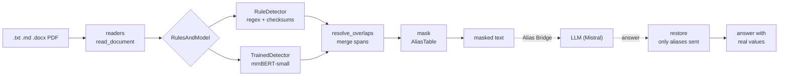

# Alias

[](https://github.com/gabrielkpo/alias/actions/workflows/ci.yml)
[](https://github.com/gabrielkpo/alias/releases)
[](https://huggingface.co/spaces/Gabrielkph/alias)
[](LICENSE)

Alias masks the personal data in a French or English document **on your own machine**, so the
text can go to an LLM without the names, IBANs or social security numbers, then puts the real
values back into the answer.

**Try it:** [public demo](https://huggingface.co/spaces/Gabrielkph/alias), the detector running in
your browser (fictitious data only): mask a text, send it to the LLM you use, paste its answer
back and get the real values again. Model:
[Gabrielkph/alias-mmbert-small](https://huggingface.co/Gabrielkph/alias-mmbert-small).

> **Status:** work in progress (see [Roadmap](#status-and-roadmap)). The detector (rules + a
> fine-tuned mmBERT-small) is chosen and measured: recall 0.98 and leak rate 1.1 % on the
> synthetic test split, 0.93 and 3.5 % on documents written by an LLM it never saw, 12.5 % of
> names left readable on English court judgments (see [Results](#results)). It runs in a local
> API and page, a Docker image, a public demo and Alias Bridge. Expect breaking changes.

## Why
Hospitals, banks and public bodies want to use LLMs on their documents, but cannot send a
patient's name, an IBAN or a French NIR to an external API. Masking has to happen **before** the
call, on the client's machine, and the answer must come back with the real values.
Off-the-shelf recognisers are English-first: Presidio has no French national ID, and generic NER
models neither tell an IBAN from a phone number nor keep one alias per person. Alias is built
for French and English, measured on recall, and runs locally.

## How it works



The alias table (`[PERSON_1]` → "Jean Dupont") never leaves the machine; only the masked text does.

Choices and trade-offs:
- **Rules for what they prove, a model for context.** IBANs and national IDs are caught exactly by
  checksums; names, addresses and birth dates need context, so a trained model handles them.
- **Stable aliases.** The same value keeps the same alias across a document (`01 99 00…` and
  `+33 1 99 00…` are one phone), so the LLM can follow who is who; two e-mail addresses that
  differ by a dot keep two aliases. The cost is a table to keep, and to protect.
- **Recall first.** A missed value leaks; a false positive only hides a word. Overlapping spans
  are merged rather than dropped, so no part of a value stays in clear.
- **Restoring is scoped to the exchange**; the bridge never restores inside a link or an image.
- **Local.** The model runs on an ordinary CPU, without a GPU.

## Example

```python
from alias_pii.masking import mask, restore
from alias_pii.rules import RuleDetector

result = mask(
    "Écrire à jean.dupont@example.com, IBAN FR76 3000 6000 0112 3456 7890 189.", RuleDetector()
)
result.text  # "Écrire à [EMAIL_1], IBAN [IBAN_1]."  <- only this goes to the LLM
answer = "Virement vers [IBAN_1] confirmé."
restore(answer, result).text  # real IBAN back, only for aliases sent in this exchange
```

**Alias Bridge** does this for tools that already call Mistral (a script, an SDK, LibreChat…):
they change only their base URL to `http://127.0.0.1:8001/v1`; the bridge masks each request,
refuses what it cannot mask and restores the answer ([docs/BRIDGE.md](docs/BRIDGE.md)).

## Status and roadmap

| Step | Content | State |
|---|---|---|
| 1 | Rules (FR + EN), masking, restoring, leak check | done |
| 2 | File readers; dataset: grid generator, LLM-written documents, public corpora | done |
| 3 | Benchmark; baselines: rules, Presidio + spaCy, GLiNER, rules + GLiNER, Mistral zero-shot | done |
| 4 | Three multilingual encoders trained, mmBERT-small kept | done |
| 5 | Rules + model detector | done |
| 6 | Local API and page, Docker CPU image, public demo in the browser | done |
| 7 | Real documents: English court judgments (TAB) measured; French sets | in progress |
| 8 | Alias Bridge: local Mistral-compatible endpoint, streaming (done); `alias-pii serve` command, Docker, macOS app | in progress |

## Results
Baselines and the fine-tuned model on the synthetic test split, 4,200 documents in French,
English and mixed (grid generator, gretel and WikiNER), read once by the chosen model after the
choice was made on the validation split. Comments, out-of-distribution and real-document results,
and the limits of these measures: [docs/RESULTS.md](docs/RESULTS.md).

| Method | Precision | Recall | Leak rate | ms / 1,000 chars (CPU) |
|---|---|---|---|---|
| rules | 0.66 | 0.33 | 66.6 % | 1 |
| Presidio + spaCy lg | 0.46 | 0.48 | 34.8 % | 40 |
| GLiNER multi PII | 0.63 | 0.74 | 22.5 % | 374 |
| rules + GLiNER (hybrid) | 0.63 | 0.85 | 12.6 % | about 375 |
| Mistral zero-shot (`mistral-small-latest`, API; first 1,000 documents) | 0.82 | 0.87 | 10.1 % | about 1,870 (network) |
| **Alias model: mmBERT-small fine-tuned** | **0.97** | **0.98** | **1.1 %** | about 360 |

- The model leaks ten times less than the best baseline on this split. On 200 documents written
  by an LLM absent from training it keeps recall 0.93 and leak rate 3.5 % (rules + GLiNER: 8.1 %).
- On 127 English court judgments (TAB), 12.5 % of names stay readable after masking.
- Training and test splits share some templates and fake names: the other two are fairer.

## Run it
Requires Python 3.12 and [uv](https://docs.astral.sh/uv/).

```
git clone https://github.com/gabrielkpo/alias && cd alias
uv sync --group dev && uv run pytest
uv sync --extra app --extra model
uv run hf download Gabrielkph/alias-mmbert-small --revision v1.0 --local-dir models/mmbert-small/final
uv run python -m alias_pii.app --model models/mmbert-small/final   # page at http://127.0.0.1:8000
```

The page and `POST /api/mask` return the masked text and each span's type, position and alias,
never the values; nothing is loaded from outside. The bridge: [docs/BRIDGE.md](docs/BRIDGE.md);
Docker: the `Dockerfile`; input formats: [docs/READERS.md](docs/READERS.md).

## Entity types

| Label | Content | Detected by |
|---|---|---|
| `PERSON`, `ADDRESS` | need context | model |
| `EMAIL`, `PHONE` | e-mail (accented domains too); French, UK and US numbers | model (the rules find them too, but are not kept: docs/DETECTOR.md) |
| `IBAN` | any country | rules (mod 97, length per country) and model |
| `NATIONAL_ID` | `FR_NIR`, `US_SSN`, `UK_NINO` | rules (checksum) and model |
| `IDENTIFIER` | file, contract or customer number after a keyword | model; rules after a person's-file keyword |
| `BIRTH_DATE` | date of birth | rules after a keyword ("né(e) le", "DOB"), model otherwise |

## Project structure

| Path | Content |
|---|---|
| `src/alias_pii/` | rules, masking, readers, trained detector, web API (`app.py`), Alias Bridge (`bridge.py`), dataset build and benchmark |
| `demo/` | the detector ported to JavaScript, run in the browser (docs/DEMO.md) |
| `docs/`, `results/` | design and measurement notes; training records |
| `tests/` | tests; `tests/README.md` lists allowed fixture values |

## Data and privacy
- **In the repository:** code, and test values that cannot reach a real person (reserved e-mail
  domains, French fiction phone ranges, published example IBANs).
- **Never in the repository:** real documents. Hand-annotated real texts live in `data/real/`,
  ignored by Git.
- **Never sent to a third party:** real texts; only synthetic and public data go to an LLM API
  or a notebook service. No weights trained on real data are published.
- **Training data:** synthetic Faker text (MIT), WikiNER French (CC BY 4.0; it holds names of
  public figures), gretel synthetic PII finance multilingual (Apache-2.0). How the dataset is
  built and checked: [docs/DATASET.md](docs/DATASET.md).

## What it is not
Alias is a component, not an anonymity guarantee and not a GDPR compliance tool. Context can
still identify a person after masking (a job title, a rare event), and no detector has perfect
recall: what it misses reaches the LLM in clear.

## Limitations
- Payment card numbers and other values outside the entity types are not detected.
- Name variants ("M. Dupont" and "Jean Dupont") do not share an alias yet.
- A 4-digit year after a keyword (`compte 2024`) is flagged as an identifier (recall first).
- An SSN needs its dashes or spaces; a NIR without its key is missed by the rules.
- libphonenumber rejects unallocated ranges, so a number from a very recent range can be missed.

## Development
- `uv sync --group dev`, then `uv run pytest`, `uv run ruff check .` and `uv run ruff format .`.
- Pre-commit runs ruff and gitleaks: `pre-commit install`.
- One pull request per change, Conventional Commits titles, squash merge; each PR goes through a
  security review and a code review, and CI must be green. Releases: release-please.

## License
MIT, see [LICENSE](LICENSE).
