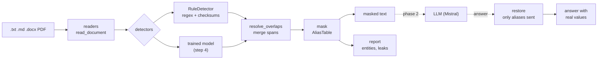

# Alias

[](https://github.com/gabrielkpo/alias/actions/workflows/ci.yml)
[](LICENSE)

Alias masks the personal data in a French or English document **on your own machine**, so the
text can go to an LLM without the names, IBANs or social security numbers, then puts the real
values back into the answer.

> **Status:** work in progress, step 2 of 7 (see [Roadmap](#status-and-roadmap)). The rule layer,
> masking and restoring work; the trained model is not there yet. Expect breaking changes.

## Why
Hospitals, banks and public bodies want to use LLMs on their documents, but cannot send a
patient's name, an IBAN or a French NIR to an external API. Masking has to happen **before** the
call, on the client's machine, without breaking the meaning of the text, and the answer must come
back with the real values. Off-the-shelf recognisers are English-first: Presidio has no French
national ID, and generic NER models do not know an IBAN from a phone number or keep the same
alias for the same person across a document. Alias is built for French and English documents,
measured on recall, and runs locally.

## How it works



The alias table (`[PERSON_1]` → "Jean Dupont") never leaves the machine; only the masked text does.

Choices and trade-offs:
- **Rules first, model next.** Formats with a checksum (IBAN, NIR) are caught exactly by rules;
  names, addresses and birth dates need context, so a trained model will handle them. Rules give
  the low baseline the model has to beat.
- **Stable aliases rather than generic placeholders.** The same value keeps the same alias across
  a document (`01 99 00…` and `+33 1 99 00…` are one phone), so the LLM can follow who is who. The
  cost is a table to keep, and to protect.
- **Recall first.** A missed value leaks; a false positive only hides a word. Overlapping spans
  are merged rather than dropped, so no part of a value stays in clear.
- **Refuse rather than guess.** A file whose encoding is ambiguous is refused: a wrong guess
  hides data from the rules while staying exactly recoverable.
- **Restoring is scoped to the exchange.** Only aliases written in the text actually sent are
  restored, so a document containing a literal `[EMAIL_1]` cannot pull a value from another one.
- **Local rather than an API.** Slower to build and to measure, but nothing personal leaves the
  machine; the model has to run on a laptop CPU (Mac M1, 8 GB).

## Example

```python
from alias_pii.masking import mask, restore
from alias_pii.rules import RuleDetector

result = mask(
    "Écrire à jean.dupont@example.com, IBAN FR76 3000 6000 0112 3456 7890 189.", RuleDetector()
)
result.text  # "Écrire à [EMAIL_1], IBAN [IBAN_1]."  <- only this goes to the LLM
answer = "Virement vers [IBAN_1] confirmé."
restore(answer, result).text  # real IBAN back, only for aliases sent in this exchange
```

## Status and roadmap

| Step | Content | State |
|---|---|---|
| 1 | Rules (FR + EN), masking, restoring, leak check | done |
| 2 | File readers; dataset v0.2 (grid generator, gates, balancer, datasheet) done; LLM-written documents, public corpora, real sets | in progress |
| 3 | Benchmark harness; baselines: rules, Presidio + spaCy, GLiNER multi PII, Mistral zero-shot | planned |
| 4 | Train three multilingual encoders (mmBERT-small, XLM-RoBERTa-base, mDeBERTa-v3-base), keep the best | planned |
| 5 | Rules + model, leak rate | planned |
| 6 | `alias-pii mask` CLI, JSON report, local API, Docker; CPU latency and memory | planned |
| 7 | Held-out test, results | planned |
| 8 | Phase 2: `alias-pii run --llm mistral`, end-to-end restoring | planned |

**Evaluation plan.** Every method runs on the same data: a synthetic validation set (Faker
`fr_FR`, `en_US`, `en_GB`), and two small real sets annotated by hand (French and English), read
once at the end. Measures: recall and precision per entity type and per language, **leak rate**
(values still readable in the masked text), CPU latency and memory. The model choice is written
before training: below one second per page on the Mac CPU, then the best entity-level recall on
`PERSON`, `ADDRESS` and `BIRTH_DATE` averaged over French and English, then the lowest leak rate.
Negative results will be published.

## Input files
`read_document(path)` turns a file into plain text before detection:

| Format | What is read |
|---|---|
| `.txt`, `.md` | UTF-8, UTF-16, UTF-32; UTF-8 and Windows-1252 decided per character (reported); ambiguous mixes refused; NFC |
| `.docx` | body, tables (nested too), headers and footers (first-page and even-page too), text boxes, content controls (inline, block, in cells), tracked insertions, footnotes, endnotes, comments |
| PDF with a text layer | every page (joined with a form feed), then filled-in form fields and annotation texts |

What still cannot be read is reported in
`Document.warnings`: scanned pages (OCR is not supported yet), charts, SmartArt and embedded
objects. Broken, encrypted or binary files raise `UnsupportedFileError`.

Known limits of the readers:
- Invisible or special spaces inside a value (zero-width space, soft hyphen, no-break space in an
  IBAN, narrow no-break space in a phone number) stop detection; the value stays readable.
- UTF-8 or Windows-1252 is decided per character from a list of characters plausible in French or
  English: anything else (CJK, Hebrew, Arabic, full-width) comes out garbled.
- UTF-16 or UTF-32 mixed with another encoding is refused; convert the file to UTF-8.
- Some PDFs (LaTeX) store an accent before its letter ("R´ef´erence"): accented keywords then miss.
- Non-standard PDF strings (UTF-8 in PDF 2.0 annotations and form fields) are decoded as
  PDFDocEncoding by pypdf.

## Entity types

| Label | Content | Detected by |
|---|---|---|
| `EMAIL` | e-mail, including accented domains | rules |
| `PHONE` | French, UK and US numbers | rules (libphonenumber) |
| `IBAN` | any country | rules (mod 97, length per country) |
| `NATIONAL_ID` | `FR_NIR` (key, Corsica), `US_SSN`, `UK_NINO` | rules |
| `IDENTIFIER` | file, contract or customer number after a keyword | rules |
| `PERSON`, `ADDRESS`, `BIRTH_DATE` | need context | trained model (step 4) |

## Run it
Requires Python 3.12 and [uv](https://docs.astral.sh/uv/).

```
git clone https://github.com/gabrielkpo/alias && cd alias
uv sync --group dev
uv run pytest
```


## Project structure

| Path | Content |
|---|---|
| `src/alias_pii/entities.py` | entity types, spans, overlap merging |
| `src/alias_pii/rules.py`, `validators.py` | rule detector, IBAN and NIR checksums |
| `src/alias_pii/masking.py` | alias table, `mask`, `restore`, `find_leaks` |
| `src/alias_pii/readers.py` | `read_document`: .txt, .md, .docx, text PDFs to plain text |
| `src/alias_pii/identities.py`, `documents.py` | fake identities; grid document generator |
| `src/alias_pii/quality.py`, `build_dataset.py` | quality gates; dataset build and datasheet |
| `tests/` | unit tests; `tests/README.md` lists allowed fixture values |

## Data and privacy
- **In the repository:** code, and test values that cannot reach a real person (RFC 2606
  domains, French fiction phone ranges, Ofcom drama numbers, published example IBANs).
- **Never in the repository:** real documents. Hand-annotated real texts live in `data/real/`,
  ignored by Git.
- **Never sent to a third party:** real texts do not go to Kaggle, Colab or an LLM API; only
  synthetic and public data do. No weights trained on real data are published.
- **Dataset:** how the training data is built, labelled, balanced and checked is specified in
  [docs/DATASET.md](docs/DATASET.md). It is generated locally and never committed:
  `uv run --group data python -m alias_pii.build_dataset --out data/synthetic`.
- **Training data:** synthetic Faker text (MIT), WikiNER French (CC BY 4.0), gretel synthetic PII
  finance multilingual (Apache-2.0).

## What it is not
Alias is a component, not an anonymity guarantee and not a GDPR compliance tool. Context can
still identify a person after masking (a job title, a rare event), and no detector has perfect
recall.

## Limitations
- `PERSON`, `ADDRESS` and `BIRTH_DATE` are not detected until the model exists (step 4).
- A 4-digit year after a keyword (`compte 2024`) is flagged as an identifier (recall first).
- An SSN needs its dashes or spaces; a NIR without its key is missed.
- Name variants ("M. Dupont" and "Jean Dupont") do not share an alias yet.
- libphonenumber rejects unallocated ranges, so a number from a very recent range can be missed.

## Development
- `uv sync --group dev`, then `uv run pytest`, `uv run ruff check .` and `uv run ruff format .`.
- Pre-commit runs ruff and gitleaks: `pre-commit install`.
- One pull request per change, Conventional Commits titles, squash merge; each PR goes through a
  security review and a code review, and CI (tests, gitleaks, CodeQL, title check) must be green.
- Releases: release-please.

## License
MIT, see [LICENSE](LICENSE).
