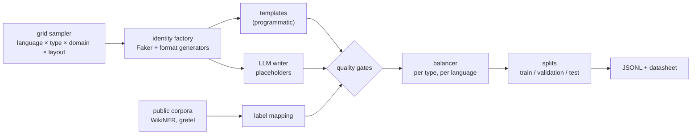

# Alias dataset: specification

> Status: **version 0.2 built** (identity factory, grid generator, quality gates, balancer,
> datasheet); LLM-written documents and public corpora come next (§12). This document
> describes how the training, validation and test data of Alias are built, labelled, balanced and
> checked. Every number below is a target; the built dataset will report its actual composition in
> a generated datasheet (`data/DATASHEET.md`).

## 1. Purpose and principles

Alias detects personal data in French and English documents so it can be masked before the text
goes to an LLM. The detector is only as good as the data it learns from, and its scores are only
as honest as the data it is measured on. Five principles drive every choice below:

1. **Exact labels.** Every span is known by construction, character for character. No label is
   guessed after the fact.
2. **Coverage before volume.** A document type, a domain or a surface form the model has never
   seen is where it will leak. The dataset is built from a grid of explicit axes and its coverage
   is measured, cell by cell.
3. **Balance.** Every entity type weighs roughly the same in training, in each language, so the
   rare types (birth dates, national IDs) are not drowned by names and e-mails.
4. **No real personal data in training.** Real documents never leave the machine and never train
   a model. They are only used, at the end, to measure the gap between synthetic and real text.
5. **Reproducible.** The whole dataset is regenerated from code, seeds and versioned prompts. It is
   never committed.

## 2. Label schema and annotation guidelines

| Label | What is labelled | Boundaries |
|---|---|---|
| `PERSON` | name of a natural person, full or partial ("Jean Dupont", "Dupont", "J. Dupont") | the name only; honorifics ("M.", "Mrs", "Dr") excluded |
| `ADDRESS` | postal address of a person | from street number to city, postcode included, across line breaks; a city alone is not an address |
| `EMAIL` | e-mail address | the address only, without `mailto:` or angle brackets |
| `PHONE` | phone or fax number of a person | the number with its prefix (`+33`, `(415)`); not the "Tél." label |
| `IBAN` | bank account number | the full IBAN, spaces included |
| `NATIONAL_ID` | French NIR, US SSN, UK NINO | the full number with its key or suffix |
| `BIRTH_DATE` | date of birth of a person | the date only; other dates are not labelled |
| `IDENTIFIER` | number that identifies a person's file, contract, account or claim | the value only, not the keyword |

Decisions on ambiguous cases:

- **Public figures** are labelled `PERSON` like anyone else: the tool cannot know who is public.
- **Organisations** are not labelled (not personal data); a company's switchboard number or
  generic e-mail (`contact@`) is not labelled either.
- **Places** that are not someone's address ("rue de Rivoli" as a landmark, a city in a date line)
  are not labelled.
- **Ages** are not labelled; birth dates are, in every format.

These guidelines are also the instructions for the hand-annotated real sets, so synthetic and
real labels mean the same thing.

## 3. Diversity grid

Each document is drawn from one cell of this grid. The generator tracks how many documents and
entities fall in each value of each axis, and the datasheet reports it.

| Axis | Values |
|---|---|
| Language | French, English (US and UK), mixed French/English documents |
| Document type | letter, e-mail (with quoted replies), form, invoice, contract, medical report, HR file, bank statement, insurance claim, legal document, administrative letter, CV, support ticket, SMS or chat, meeting minutes, notes, table or CSV |
| Domain | health, banking, insurance, HR, public administration, legal, real estate, education, telecoms, e-commerce |
| Layout | prose, bullet lists, `key: value` forms, tables, headers and signatures, quoted threads |
| Register and noise | formal, casual, chat style without punctuation, upper case, typos, extra line breaks |

Surface forms are varied inside each entity type:

| Type | Variants |
|---|---|
| `PERSON` | first and last name, last name only, initials, compound and hyphenated names, particles (de, van, O'), names of many origins, upper case |
| `ADDRESS` | French (bis, lieu-dit, cedex), UK (flat, postcode), US (suite, ZIP), one line or several |
| `PHONE` | national and international, spaced, dotted, dashed, compact, with or without parentheses |
| `IBAN` | grouped by four, compact, lower case, several countries |
| `NATIONAL_ID` | NIR spaced or compact, Corsica 2A/2B; SSN; NINO with and without spaces |
| `BIRTH_DATE` | numeric (day-month and month-day), written months, "né le", "DOB", "date of birth" |
| `IDENTIFIER` | many keywords (dossier, contrat, référence client, matricule, policy, claim, customer ID) and formats |

## 4. Sources



### 4.1 Grid generator (programmatic)
Rather than a hundred fixed templates, documents are **assembled** (`src/alias_pii/documents.py`):
a document type chooses the personal fields it carries (always-present fields plus optional ones
drawn by the balancer), a layout arranges them (prose, `key: value` form, table or CSV, e-mail
thread, chat), phrase banks in French and English word them, and declared distractors are mixed
in. Spans are recorded while the text is built, so labels are exact by construction. Values come
from the identity factory (`src/alias_pii/identities.py`): names of sixteen origins, compound and
double names, seven name styles, French, UK and US addresses, e-mails derived from the name,
phones in allocated ranges, IBANs from eight countries, NIR (Corsica included), SSN and NINO, each
in several surface forms. Neutral context sentences of the document's domain (`src/alias_pii/phrasebank.py`, ten
domains, French and English) surround the personal fields, as in real documents; sentences carrying
two values ("Contact: {PHONE} / {EMAIL}") and values at the start, middle or in brackets vary the
patterns. A light noise step swaps letters in the literal text only.

Measured on version 0.2 (1,500 documents per split): about 100 words per document; personal data
is 13 to 15 % of the characters overall, about 10 % in prose and e-mails, 15 to 22 % in forms,
tables and chats, which are dense by nature. Grid documents are fluent sentence by sentence but less
coherent as a whole (a CV can open with "Dear customer"): coverage of formats and patterns is their
job, coherence is the job of the LLM-written source.
Generation is free and fast (about 4,000 documents in 11 seconds); the cost is phrasing that
stays more regular than real text, which the LLM-written source (4.2) addresses.

### 4.2 LLM-written documents with placeholders
This is the main source of diversity. The labels stay exact because the LLM never sees or invents
a value:

1. The identity factory draws a fake identity: name, address, phone, IBAN, national ID, birth
   date, identifier.
2. The LLM (Mistral) is asked for one document of a given cell of the grid ("a French insurance
   claim, written as a casual e-mail with a quoted reply"), using placeholders such as
   `{{PERSON_1}}`, `{{IBAN_1}}`, plus distractors it must include (a non-birth date, an amount, a
   company).
3. The placeholders are replaced by the values; spans are computed during the substitution.
4. A document is rejected if a placeholder is missing, unknown, malformed, or if the text contains
   anything that looks like personal data outside the placeholders (checked by the rule detector).

Only fake values ever reach the API. Prompts are versioned in the repository, and each record keeps
the model name and prompt version that produced it.

### 4.3 Public corpora
| Corpus | Licence | Use |
|---|---|---|
| WikiNER (French, English) | CC BY 4.0 | person names in real sentences; only `PER` is mapped to `PERSON` (its locations are not addresses) |
| gretelai/synthetic_pii_finance_multilingual (French, English parts) | Apache-2.0 | financial documents written by an LLM; labels mapped to the Alias schema |

Excluded for licence reasons: ai4privacy (non-commercial or unclear terms), WikiNEuRal and
MultiNERD (CC BY-NC-SA), CATIE-AQ frenchNER (contains them).

## 5. Hard negatives
Documents deliberately contain values that look personal but are not, so the model also learns
what not to mask: dates of events, invoice and product numbers, amounts, company names, a company's
switchboard, generic mailboxes, street names used as places, public institutions. They stay
unlabelled, and each document type has a target share of them.

## 6. Balance and size

- **Training set:** optional fields are drawn toward an equal share per label. Measured on
  version 0.2: every label between 8 % and 14 % of the spans except `PERSON` (about 24 %), since
  almost every document names someone, often twice. A strict 12.5 % per label would need
  documents without people, which would be unrealistic.
- **Natural validation set:** realistic proportions (names and e-mails dominate), to measure
  precision honestly.
- **Target size:** about 30,000 training documents, 3,000 validation, 3,000 test, in equal parts
  French and English, plus a few hundred mixed documents.

## 7. Splits and leakage prevention
- Templates and LLM prompt families are split between train, validation and test.
- No fake identity is shared between splits.
- One document type is held out entirely for the test set, to measure generalisation to a format
  never seen in training.
- Public corpora are split by their own document boundaries.
- The hand-annotated real sets (French and English, a few dozen documents each) are only read for
  the final evaluation.

## 8. Quality gates
Automatic, on every document:
- each span matches its value exactly, is non-empty and has no leading or trailing space;
- no overlapping spans; labels belong to the schema;
- for e-mails, phones, IBANs and national IDs, the rule detector finds the span (format realism);
- no value outside a span is detected as personal data by the rules (unlabelled leaks);
- exact and near duplicates are removed.

Manual: a stratified sample of about 200 documents is reviewed against the guidelines before each
dataset version is used for training; errors found are fixed in the generator, not in the data.

## 9. Format and reproducibility
One JSON object per line:

```json
{"text": "...", "spans": [{"start": 12, "end": 23, "label": "PERSON"}],
 "language": "fr", "locale": "fr_FR", "doc_type": "insurance_claim", "domain": "insurance",
 "layout": "email", "source": "llm", "generator": "mistral-...|prompt-v1", "split": "train"}
```

The dataset is regenerated with one command from a seed:
`uv run --group data python -m alias_pii.build_dataset --out data/synthetic --seed 0`. A datasheet is generated alongside it:
composition per axis and per label, sources and licences, rejected-document counts, version.

## 10. Privacy and ethics
- No real person's data is used for training; fake values come from Faker and format generators.
- Generated values can coincide with a real person by chance; the dataset is therefore never
  published, only the code that builds it.
- Real annotated documents stay in `data/real/`, ignored by Git, and are never sent to a third
  party (no API, Kaggle or Colab).
- Names of many origins are included on purpose, and recall is reported by name origin where
  possible, so the detector does not work only for common French and English names.

## 11. Known limitations
- Synthetic text, even LLM-written, is more regular than real documents: the gap is measured on
  the real sets and reported.
- Scanned documents and OCR noise are out of scope for this version.
- Labels follow the guidelines above; another definition of personal data (for example, labelling
  organisations) would need new data.

## 12. Versions
| Version | Content |
|---|---|
| 0.1 | this specification; first 12 templates (done) |
| 0.2 | identity factory, grid generator (14 document types × 5 layouts × 2 languages + mixed), quality gates, balancer, datasheet, build command (done) |
| 0.3 | LLM-written documents with placeholders |
| 0.4 | public corpora mapped; first full build and manual review |
